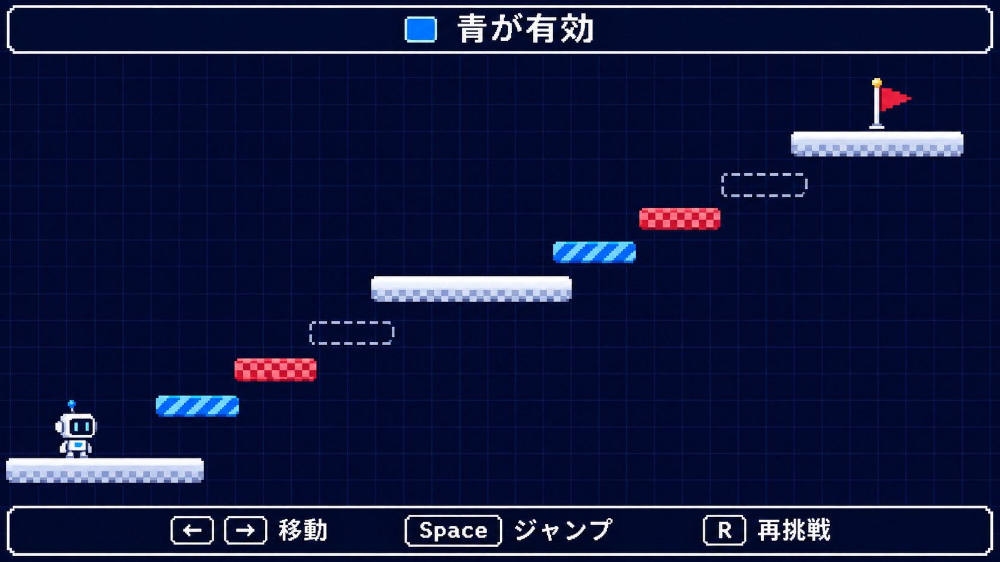

# 一画面ジャンプアクションの仕様

作成日: 2026-11-25
状態: 仕様検討中（実装開始の指示ではない）

## 目的・背景

一画面で完結する、簡単なジャンプアクションを作る。左下から足場を上り、画面上部のゴールを目指す。
ジャンプに連動して有効な足場が切り替わる仕組みを特徴とし、次の着地点を考える楽しさを加える。

## 対象ユーザー・利用場面

Windows 11 PCで、短いステージの移動とジャンプを楽しみたい人を想定する。キーボードとゲームパッドを使用し、配布された実行ファイルからゲームを起動する。

## 対象範囲

### 対象

- プレイヤーの移動、ジャンプ、足場への着地。
- 足場の切り替えと状態表示。
- ゴール判定、落下後の再挑戦、クリア表示。
- 固定配置の1ステージ。

### 初期版の対象外

- 敵、制限時間、残機、スコア、ランキング。
- 二段ジャンプ、チェックポイント、ステージの自動生成。
- 複数ステージ、オンライン機能、進行状況の保存。

## 機能要件

| ID | 要件 |
| --- | --- | --- |
| FR-001 | ステージ全体をスクロールしない一画面に表示する。 |
| FR-002 | プレイヤーは画面左下の開始位置からプレイを始める。 |
| FR-003 | プレイヤーは左右移動とジャンプを操作でき、足場を使って上へ進める。 |
| FR-004 | 画面上部のゴール足場に着地するとゲームクリアになる。 |
| FR-005 | 足場から落下して失敗した場合、左下の開始位置からやり直す。落下中に別の足場に着地できた場合は継続する。 |
| FR-006 | ジャンプの高さは一定とし、空中でも左右移動できる。空中での追加ジャンプはできない。 |
| FR-007 | 赤、青、常時有効の3種類の足場を設ける。赤、青のうち有効になるのは一方のみとする。 |
| FR-008 | 開始時は赤を有効にする。地上でジャンプが成立した瞬間に有効色を反転し、最初のジャンプでは青が有効になる。空中でのジャンプ入力では反転しない。 |
| FR-009 | 有効な足場には着地でき、無効な足場は上下どちらからもすり抜ける。切り替えで踏み切った足場が無効になってもジャンプは成立する。 |
| FR-010 | 常時有効の足場をスタート、途中の休憩場所、ゴールに使用する。休憩場所は再開地点にならない。 |
| FR-011 | 有効な足場は塗りつぶし、無効な足場は薄い輪郭で表示する。赤と青は模様も変え、色だけに依存せず区別できるようにする。 |
| FR-012 | プレイヤーが画面下へ落ちたら自動的に再開する。プレイヤーの位置と移動状態、足場の有効色を開始時の状態に戻す。 |
| FR-013 | クリア後は同じ画面にクリア表示と「もう一度」ボタンを表示する。再挑戦を選ぶと開始時の状態に戻る。 |
| FR-014 | キーボードとゲームパッドの両方で左右移動とジャンプを操作できる。具体的なキーとボタンの割り当ては FR-015 に定める。 |
| FR-015 | キーボードは A/D または左右矢印で移動、Space でジャンプ、R で再挑戦する。ゲームパッドは左スティックまたは十字キーで移動し、南側の主ボタン（Xbox 配置の A）でジャンプする。 |
| FR-016 | ジャンプボタンを押した時点で一定の高さにジャンプする。ジャンプボタンを離しても高さは変わらず、空中での左右移動は地上と同じ速度とする。初期値は水平移動速度 120 px/s、ジャンプ初速 300 px/s、重力加速度 900 px/s²、基準解像度 640×360 px とする。 |
| FR-017 | 有効色は地上からジャンプが成立した瞬間に反転する。ジャンプボタンを押し続けても、着地後に新たな押下があるまで次のジャンプは発生しない。 |
| FR-018 | ゴール足場に着地した時点でクリアとし、クリア中はプレイヤー操作を停止する。再挑戦は画面上のボタン、R キー、ゲームパッドの Start/Options ボタンで行える。 |
| FR-019 | 画面下端を越えたら短い落下演出の後に開始位置へ戻す。再挑戦時は有効色を赤に戻す。 |
| FR-020 | ウィンドウの縦横比が変わってもステージ全体を表示し、余白を追加して基準のゲーム画面比率を保つ。基準比率は16:9とする。 |
| FR-021 | Windows 11で起動できる実行ファイル（.exe）を作成し、プレイヤーが実行ファイルからゲームを起動できるようにする。 |
| FR-022 | プレイヤーは左右の画面端を越えない。左右同時入力は相殺する。足場は上面のみ着地判定を持ち、側面と下面はすり抜ける。 |
| FR-023 | 無効化された足場が有効に戻る際にプレイヤーと重なっている場合、その足場との衝突判定をプレイヤーが離れるまで一時的に無効にする。 |
| FR-024 | 固定ステージ1面とし、スタートを含め足場を12〜16個、常時有効の休憩足場を2個配置する。必須ルートでは、各ジャンプの反転後に有効な足場へ着地できる配置にする。 |
| FR-025 | 起動後はタイトル画面を挟まず、操作可能なステージを直接表示する。落下演出は約0.5秒とし、終了後に開始位置へ戻す。 |
| FR-026 | Pythonなどの実行環境を別途インストールせずに起動できるよう、必要なランタイムを含む単体の `.exe` を配布する。`.exe` は圧縮アーカイブにまとめず、そのまま配布する。 |
| FR-027 | 画面は暗い紺色を基調とし、薄い格子模様の背景を使う。背景の模様は足場やプレイヤーの視認を妨げない濃さにする。 |
| FR-028 | プレイヤーは白を基調とした小型ロボットとして描く。描画は12×16 pxのプレイヤー領域内に収め、背景や足場と明確に見分けられる形にする。 |
| FR-029 | 赤・青の足場はそれぞれ色に加えて異なる模様で区別する。有効な色の足場は塗りつぶし、無効な色の足場は薄い輪郭で表示する。常時有効な足場は淡い白で表示する。 |
| FR-030 | 画面上部に現在有効な色と「赤が有効」または「青が有効」の文字を表示する。開始時と再挑戦後は赤が有効と表示する。 |
| FR-031 | 画面下部にキーボード操作（左右移動、Spaceでジャンプ、Rで再挑戦）を常時表示する。ゲームパッドが操作に使われている場合は、対応する方向入力、Aボタン、Startボタンの案内に切り替える。案内は足場やプレイヤーを覆わない領域に配置する。 |
| FR-032 | ゴール足場に旗を表示し、休憩足場は淡い白で表示して色付き足場と区別する。 |
| FR-033 | クリア時は画面中央に「CLEAR」と再挑戦操作の案内を重ねて表示する。 |

## ステージ構成

- 画面は640×360 px、左上原点。足場座標は左上 `(x, y)`、寸法は `幅×高さ`。プレイヤー寸法は12×16 px。
- ステージは16足場。必須ルートは `P01 → P02 → P03 → P04 → P05 → P06 → P07 → P08 → P09 → P10 → P11 → P12` の12足場。P13〜P15は寄り道または代替着地用、P16はすり抜け用とし、必須クリアに不要。
- P01は常時有効な開始足場、P06とP10は常時有効な休憩足場、P12は常時有効なゴール足場。足場総数16には必須ルート12個と補助足場4個を含む。
- 開始時は赤が有効。ジャンプ成立ごとに色を反転するため、必須ルートで着地する色付き足場の順は青、赤、青、赤、赤、青、赤、赤（休憩足場を除く）。常時有効足場への着地は色順を中断しない。
- 各必須着地は前の足場より26 px高い。ジャンプ初速300 px/s、重力900 px/s²では、26 px高い面に下降中に届くまで約0.56秒あり、水平移動上限は約67.7 px。隣接する必須足場の中心間距離を67 px以下にする。

### 必須ルート足場

| ID | x | y | 幅×高さ | 種類 | 区間の役割 |
| --- | ---: | ---: | ---: | --- | --- |
| P01 | 24 | 338 | 100×8 | 常時有効 | 左下スタート |
| P02 | 54 | 312 | 44×8 | 青 | 最初の色切替を体験 |
| P03 | 96 | 286 | 44×8 | 赤 | 交互着地を学ぶ |
| P04 | 138 | 260 | 44×8 | 青 | 右方向へ移動 |
| P05 | 180 | 234 | 44×8 | 赤 | 初級区間の終点 |
| P06 | 208 | 208 | 76×8 | 常時有効 | 第一休憩足場 |
| P07 | 166 | 182 | 44×8 | 赤 | 左へ折り返す |
| P08 | 124 | 156 | 44×8 | 青 | 色切替を継続 |
| P09 | 166 | 130 | 44×8 | 赤 | 右へ戻る |
| P10 | 194 | 104 | 76×8 | 常時有効 | 第二休憩足場 |
| P11 | 236 | 78 | 44×8 | 赤 | 上段へ進む |
| P12 | 260 | 52 | 50×8 | 常時有効 | 上部ゴール |

### 補助足場

| ID | x | y | 幅×高さ | 種類 | 用途 |
| --- | ---: | ---: | ---: | --- | --- |
| P13 | 320 | 78 | 44×8 | 青 | P11から右へ進む上段の練習分岐 |
| P14 | 360 | 52 | 44×8 | 赤 | P13から進み、P12へ戻る練習足場 |
| P15 | 154 | 286 | 44×8 | 青 | P03から右へ分岐し、P03へ戻る色切替練習足場 |
| P16 | 250 | 90 | 52×8 | 青 | P10からP11へのジャンプで無効化し、上昇中にすり抜ける仕掛け足場 |

### 区間の意図

1. P01→P02: 開始位置から最初のジャンプを試す。
2. P02→P03: 赤・青の交互切替を理解する。
3. P03→P04: 右方向への横移動を学ぶ。
4. P04→P05: 同じ操作を繰り返し、基本ルールを定着させる。
5. P05→P06: 第一休憩足場で操作を立て直す。
6. P06→P07: 左へ折り返し、休憩足場からのジャンプ後も色が切り替わることを使う。
7. P07→P08: 左方向へ進みながら交互着地を続ける。
8. P08→P09: 右へ再度折り返す。
9. P09→P10: 第二休憩足場に到達する。
10. P10→P11→P12: 上段を進み、ゴール足場へ着地する。

### 到達性とすり抜け

必須ルートの全ての隣接足場は高さ差26 px、中心間の水平距離は最大58 pxとし、理論上の水平到達上限約67.7 px以内に置く。左右方向を反転する経路を使って画面の中央部まで広がる。上昇量は必須11ジャンプで286 pxとなり、開始足場 y=338 からゴール足場 y=52 まで画面内に収まる。

補助足場P13〜P15は必須ルートから外れた練習用の分岐とし、必須ルートを短縮しない。必須ルートでP11に着地した時点では赤が有効であるため、P11からP13（青）へ進み、次のジャンプで赤に切り替えてP14（赤）へ進み、最後に常時有効のP12へ戻る任意ルートを設ける。P12への着地でクリアする。P15はP03から分岐する練習足場で、P03からジャンプすると青が有効になり着地できる。P15からP03へ戻るジャンプでは赤が有効になり、元のルートへ復帰できる。すり抜け用のP16は青、座標 `(250, 90)`、寸法 `52×8` とする。P10到達時には青が有効で、P10の右側（プレイヤー左端 x=252 px）からP11へジャンプすると赤へ切り替わるため、P16は無効化され、プレイヤーは上昇時に通過できる。P11は赤とし、下降時に着地する。足場総数は必須ルート12個と補助足場4個の合計16個。

必須ルートの隣接足場は、上昇時の高さ差26 px、中心間水平距離を最大58 pxとする。P11からP12は中心間距離27 px。任意分岐ではP11からP13は中心間84 px（同じ高さ）。P11の右端寄り（プレイヤー中心 x=274）から右へ跳べば、ゴール上面を下降通過する時点で中心は約342 pxとなり、P12を避けてP13に着地できる。P13からP14が40 px、高さ差26 px、P14からP12は同じ高さで中心間97 px。P14の左端寄り（中心 x=368）から左へ80 px移動するとP12に着地できる。P03からP15は58 px（同じ高さ）、P15からP03へ戻る距離も58 px。ジャンプ初速300 px/s、重力900 px/s²では同じ高さへの水平移動上限は80 px、26 px上昇する着地まで約0.56秒、水平移動可能距離は約67.7 px。難易度は、必須ルートを操作ルールの理解後に数回の挑戦でクリア可能な水準とし、寄り道は必須ルートより難しくする。全配置はこの物理値から算出した仕様案で、ゲーム内の操作・衝突による確認は未実施。
## 表示イメージ

以下を表示仕様の参考例とする。最終的な画素表現や細かな演出は実装時に調整する。

## 入出力・データ

- 入力: キーボードとゲームパッドによる左移動、右移動、ジャンプ。割り当ては FR-015、再挑戦操作は FR-018 を参照。
- 表示: プレイヤー、足場、ゴール、足場の有効状態、クリア表示。表示仕様は FR-027〜FR-033 に定める。
- プレイ中に保持する状態は、位置と移動状態、有効な足場色、プレイ中／落下演出中／クリアの区分とする。永続保存は行わない。

## 異常時・境界条件

- 空中でのジャンプ入力は、追加ジャンプも足場の切り替えも発生させない。
- 落下後の再開では、落下前の速度や足場の切り替え状態を引き継がない。
- ジャンプボタンを押し続けても連続ジャンプしない。着地後に新たな押下が必要。
- 無効から有効になった足場とプレイヤーが重なっている場合、その足場の衝突判定をプレイヤーが離れるまで無効にする。
- 左右端ではプレイヤーを画面内に留める。左右同時入力は相殺する。
- 足場は上面のみ着地判定を持ち、側面と下面はすり抜ける。
- クリア後はプレイヤー操作を停止する。

## 非機能要件・制約

- 本 plan は仕様検討段階とし、使用ライブラリは次項に定め、詳細な実装方式は設計時に決定する。
- ゲームは Pyxel を使用して作成する。
- 対応OSは Windows 11 とする。成果物としてゲームを起動できる `.exe` を提供する。
- 配布物は FR-026 に定める単体 `.exe` とする。
- ゲーム画面の基準解像度は640×360 px、起動時のウィンドウは960×540 pxとする。ウィンドウサイズ変更を許可し、16:9以外の領域は余白で埋める。全画面切替は設けない。
- Windowsで一般的なXInput対応ゲームパッドを対象とする。左スティックまたは十字キーで移動し、Xbox配置のAでジャンプ、Startでクリア後に再挑戦する。未対応パッドではキーボード操作を利用できる。
- ゲームはウィンドウの閉じる操作で終了する。ゲーム内の終了ボタンや終了キーは設けない。
- 単体の `.exe` を圧縮アーカイブにせず直接配布する。インストーラーと自動更新機能は設けない。
- 画面比率と表示調整は FR-020 に定める。
- 操作感の初期値は FR-016 に定め、ステージ配置はこれに合わせる。

## 受け入れ条件

受け入れ条件は機能要件の確認条件とする。

| ID | 関連要件 | 確認条件 |
| --- | --- | --- |
| AC-001 | FR-001, FR-002 | 開始時にプレイヤーが左下に表示され、ゴールまでのステージ全体をスクロールせず確認できる。 |
| AC-002 | FR-003, FR-006, FR-014 | キーボードとゲームパッドのそれぞれで左右移動とジャンプが行え、左右移動とジャンプで足場を上れる。空中で左右位置を調整でき、追加のジャンプ入力では再上昇しない。 |
| AC-003 | FR-004, FR-018 | プレイヤーがゴール足場に着地するとクリア状態になり、移動できなくなる。 |
| AC-004 | FR-005, FR-012 | 画面下へ落下すると左下から再開し、移動状態が初期化され、赤の足場が有効になる。下の足場に着地した場合は再開せず継続する。 |
| AC-005 | FR-007, FR-008 | 開始時は赤が有効で、成立したジャンプごとに青、赤の順に切り替わる。空中入力では切り替わらない。 |
| AC-006 | FR-009, FR-010 | 有効な足場と常時有効の足場には着地でき、無効な足場はすり抜ける。色付き足場からの踏み切り時にもジャンプが成立する。 |
| AC-007 | FR-011 | 赤と青を色と模様で区別でき、有効と無効を塗りつぶしと輪郭で区別できる。 |
| AC-008 | FR-013 | クリア表示と再挑戦ボタンが同じ画面内に現れ、ボタン操作で開始時の状態に戻る。 |
| AC-009 | FR-003, FR-007〜FR-010 | 固定の足場配置で、切り替えルールに従って開始位置からゴールまで到達できる。 |
| AC-010 | FR-014, FR-015 | キーボードの指定キーとゲームパッドの指定入力で移動・ジャンプでき、指定した再挑戦操作で初期状態に戻る。 |
| AC-011 | FR-016, FR-017 | ジャンプの高さが押下時間で変わらず、空中入力では再ジャンプしない。各ジャンプ成立時に一度だけ色が反転し、押しっぱなしでは着地後に再ジャンプしない。 |
| AC-012 | FR-019, FR-020 | 落下時に短い演出後スタート位置へ戻り、画面比率を変えても全ステージが表示される。 |
| AC-013 | FR-021 | Windows 11上で提供された `.exe` を起動すると、追加の開発用ツールやPython環境を求められずにゲームを開始できる。 |
| AC-014 | FR-016 | 640×360 px の基準画面で、水平速度 120 px/s、ジャンプ初速 300 px/s、重力加速度 900 px/s² を初期値として使用する。 |
| AC-015 | FR-022, FR-023 | プレイヤーは左右端を越えず、足場は上面のみで着地できる。足場の再有効化時に重なっていても押し出しや不正な落下判定が発生しない。 |
| AC-016 | FR-024 | 固定ステージは開始地点からゴールまで到達可能で、足場数と休憩足場数が指定範囲に収まる。 |
| AC-017 | FR-025, FR-026 | 起動すると直接プレイ画面が開き、落下から約0.5秒後に開始位置へ戻る。単体 `.exe` をアーカイブから展開する手順なしで起動できる。 |
| AC-018 | FR-024 | P11→P13→P14→P12の分岐とP03→P15→P03の往復が、それぞれ記載した色切替で成立し、必須ルートを短縮しない。 |
| AC-019 | FR-016, FR-024 | 必須ルートの各ジャンプについて、高さ差、水平距離、切替後の有効色、着地幅が配置表の制約を満たす。P10の指定位置から跳ぶとP16が無効になり、P11へ着地できる。 |
| AC-020 | FR-027, FR-028 | 暗い紺色と薄い格子の背景に白基調のロボットが表示され、背景・足場・プレイヤーを見分けられる。 |
| AC-021 | FR-029, FR-032 | 赤・青の足場を模様でも区別でき、有効・無効・常時有効の状態が指定の塗り・輪郭で表現される。ゴールには旗があり、休憩足場は色付き足場と区別できる。 |
| AC-022 | FR-030, FR-031 | 現在有効な色と操作案内が表示される。キーボード操作中はキーボード案内、ゲームパッド操作中はゲームパッド案内が見え、いずれもゲームプレイ領域を不必要に覆わない。 |
| AC-023 | FR-033 | ゴール到達後、画面中央に「CLEAR」と再挑戦操作が表示される。 |

